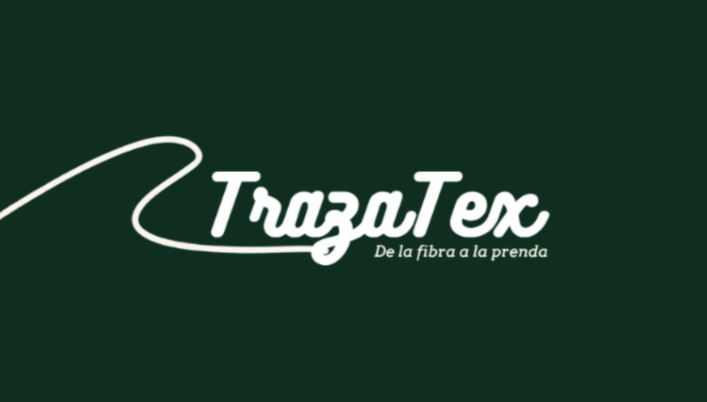

# TrazaTex API Gateway

<p align="center">
  
</p>

TrazaTex es una plataforma web de trazabilidad textil B2B que permite seguir los materiales desde la fibra hasta la prenda. Este repositorio contiene el API Gateway, encargado de recibir las solicitudes de la aplicación, dirigirlas a los microservicios y aplicar controles de autenticación y seguridad antes de acceder a las API internas.

## Tecnologías


## Features

- Enrutamiento de solicitudes hacia los microservicios de autenticación, producción, trazabilidad, calidad, notificaciones y analítica.
- Validación de tokens JWT firmados con RS256 mediante las claves públicas publicadas en JWKS.
- Distinción entre rutas públicas y protegidas antes de reenviar las solicitudes.
- Propagación de la identidad del usuario autenticado hacia los servicios internos.
- Limitación de solicitudes según la ruta y el tipo de operación con Bucket4j y Caffeine.
- Actualización de la información de revocación de usuarios a partir de eventos de Kafka.
- Configuración de CORS, validación de rutas y respuestas de error centralizadas.

## Ejecución

Se necesita **JDK 21**. Para ejecutar el Gateway integrado con TrazaTex, también deben estar disponibles los microservicios de destino, el servicio que publica las claves JWKS y Apache Kafka. Este repositorio contiene el código del Gateway y sus módulos de pruebas, pero no el Docker Compose de la plataforma completa.

Desde la raíz del repositorio, compilar en **Windows (PowerShell)**:

```powershell
.\mvnw.cmd -pl api-gateway -am clean package -DskipTests
```

En **Linux o macOS**:

```bash
./mvnw -pl api-gateway -am clean package -DskipTests
```

Iniciar el archivo ejecutable generado:

```bash
java -jar api-gateway/target/api-gateway-0.1.0-SNAPSHOT-exec.jar
```

Por defecto, el Gateway utiliza el puerto `8080`. Las direcciones de los servicios pueden configurarse mediante `ORGANIZATION_ACCESS_URL`, `PRODUCTION_URL`, `TRACEABILITY_URL`, `QUALITY_URL`, `NOTIFICATION_URL` y `ANALYTICS_URL`. La validación JWT utiliza `JWKS_URI`, y la revocación de usuarios consulta Kafka mediante `KAFKA_BOOTSTRAP_SERVERS`.

Con los servicios necesarios disponibles, comprobar el estado en `http://localhost:8080/actuator/health`.

Para ejecutar las pruebas desde la raíz del repositorio:

```bash
./mvnw verify
```

En Windows, sustituir `./mvnw` por `.\mvnw.cmd`. Algunas pruebas de integración necesitan Docker para iniciar los contenedores de prueba.

## Desarrollo

### Elección de arquitectura

Elegí un API Gateway como punto de entrada porque TrazaTex distribuye las funcionalidades entre varios microservicios y necesita controlar el acceso sin repetir toda la lógica de autenticación en cada ruta. Separé los casos de uso de los filtros y adaptadores para que las políticas de seguridad no dependan directamente del mecanismo de enrutamiento.

El Gateway utiliza un modelo reactivo, diferente del modelo Spring MVC de los microservicios de negocio. De esta manera, puede procesar y reenviar solicitudes mediante WebFlux sin incorporar la lógica productiva o de trazabilidad.

### Decisión de tecnologías

Utilicé **Spring Cloud Gateway y Spring WebFlux** para configurar las rutas y sus filtros. Para validar los tokens elegí **Nimbus JOSE**, con firmas RS256 y consulta de claves públicas mediante JWKS. También integré **Bucket4j y Caffeine** para aplicar límites de solicitudes y conservar los contadores temporalmente.

Además, incorporé **Apache Kafka** para recibir acontecimientos relacionados con la revocación de usuarios. Esto permite que las decisiones de acceso tengan en cuenta cambios de cuentas sin consultar la base de datos de otro servicio en cada solicitud.

### Construcción del software

Organicé el código en dominio, aplicación e infraestructura. Implementé la autenticación, las políticas de limitación de solicitudes, los filtros de identidad, la protección de rutas internas y el tratamiento de errores. Las direcciones de los servicios y los parámetros de seguridad se mantienen configurables mediante variables de entorno.

Incluí pruebas unitarias y de integración con **JUnit 5, Reactor Test, WireMock, Testcontainers y ArchUnit**, para revisar los casos de uso, el comportamiento HTTP y algunas restricciones de la arquitectura.

### Integración con TrazaTex

En el entorno completo, **Nginx** recibe las solicitudes de la aplicación Angular y las dirige al Gateway, que a su vez comunica cada petición al microservicio correspondiente. El Gateway no almacena información productiva ni sustituye los permisos que cada servicio debe validar sobre sus propios recursos.

### Despliegue en AWS

Desplegué TrazaTex en infraestructura de **AWS**, utilizando **Docker y Docker Compose** para ejecutar los componentes de la plataforma por separado. **Nginx** actúa como punto de entrada web y proxy inverso, mientras que el API Gateway recibe las solicitudes destinadas a los microservicios. Esta separación permite mantener los controles de acceso en el Gateway y las reglas particulares de cada contexto dentro de su servicio.

El despliegue completo depende de la configuración de los demás microservicios, la mensajería y las aplicaciones web; esas configuraciones de infraestructura no forman parte de este repositorio.
